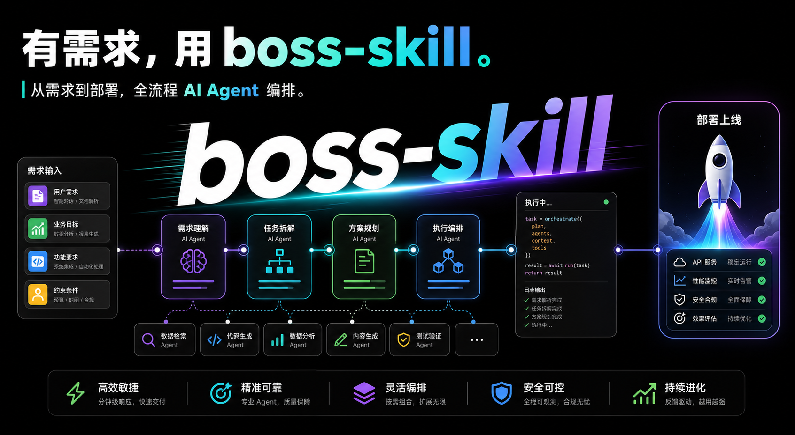

# boss-skill

[](https://skills.sh/echovic/boss-skill)
[](https://atomgit.com/echoVic/boss-skill)
[](LICENSE)

**Languages / 语言 / 言語 / 언어 / Idiomas / Langues:** [English](./README.md) · 中文 · [日本語](./README.ja.md) · [한국어](./README.ko.md) · [Español](./README.es.md) · [Français](./README.fr.md) · [Português](./README.pt-BR.md)



> 本项目属于 AtomGit G-Star 孵化计划。GitHub 是主仓库，AtomGit 是自动同步的镜像；Issue 和 PR 请在 [GitHub](https://github.com/echoVic/boss-skill) 提交。

**Boss 是给编码 Agent 用的专家小队工作流。** 它把一只编码 Agent 变成一支结构化的工程团队：PM、架构师、UI 设计、技术负责人、Scrum Master、前端、后端、QA 和 DevOps。每个角色都按硬性质量契约工作，并把结果写到磁盘，契约是否达标由独立的验证者检查，而不是作者自己。可以只让一个角色处理你已有的代码，比如评审当前分支；也可以跑完整条流水线，从一个想法一路做到 PR。

Boss 支持 Claude Code、Codex、OpenClaw、Antigravity、Hermes 和 DeepSeek Harness。

## DeepSeek Harness

Boss 也提供 DeepSeek Harness bundle：[`dsh-boss-mode`](https://www.npmjs.com/package/dsh-boss-mode)，带一个可选的 **Boss Expert Squad** 预设，以及读取实时 Agent Teams 成员和任务的右侧栏。

```bash
dsh plugin --profile desktop add dsh-boss-mode
```

重启 DeepSeek Harness，新建会话，在模式里选 **Boss Expert Squad**。

## 为什么需要 Boss

- **对现有代码同样有用**：`/boss:review` 评审当前分支的 diff，`/boss:qa` 测试它，`/boss:ship` 创建 PR。每个命令只做自己那一个阶段，做完就停。
- **硬性质量契约**：每个角色都有一张不可协商的要求表（PRD 必须有 Given-When-Then 场景，架构至少比较两个方案，QA 的每条结论都必须记录背后的命令和退出码）。
- **作者不给自己打分**：脚本能判定的由脚本检查，其余交给独立的验证 Agent 判断，并引用它的证据。契约不通过就挡住下一阶段，除非你豁免。
- **产物驱动**：每个阶段都在 `.boss/<feature>/` 下写真实文件；进度看磁盘上的产物，不看 Agent 自己怎么说。
- **默认 TDD**：开发阶段先写一个失败的测试，看它变 RED，再用最少的代码让它变 GREEN。
- **本地优先**：没有遥测，也没有远程代理。只有在你运行 `ship` 或明确同意时，Boss 才会推送、创建 PR 或部署。

## 专家小队命令

每个命令只跑一个阶段，验证后停下，并给出下一个命令：

| 命令              | 角色         | 产出                                                            |
| ----------------- | ------------ | --------------------------------------------------------------- |
| `/boss:pm`        | PM           | `prd.md`                                                        |
| `/boss:architect` | 架构师       | `architecture.md`                                               |
| `/boss:ui`        | UI 设计      | `ui-spec.md`、`ui-design.json`                                  |
| `/boss:review`    | 技术负责人   | 针对 diff 的 `code-review.md`，或 `tech-review.md` 和 `plan.md` |
| `/boss:tasks`     | Scrum Master | `tasks.md`                                                      |
| `/boss:dev`       | 前端 / 后端  | 代码和测试                                                      |
| `/boss:qa`        | QA           | `qa-report.md`                                                  |
| `/boss:ship`      | DevOps       | PR，或用 `--deploy` 做一次部署                                  |
| `/boss:verify`    | 验证者       | 针对已有产物的 `verification.md`                                |

加 `--continue` 可以沿链路继续往下跑，加 `--stop-after <stage>` 则在后面的某个阶段停下。完整链路是 `pm → architect → ui → review → tasks → dev → qa → ship`；在 Claude Code 里用 `/boss:boss <request>` 跑完整条链路，或者直接让 Boss 端到端地做出某样东西。

在 Claude Code 里，这些是真正的斜杠命令。在其他 Agent 上，调用 Boss 技能并说明阶段，例如「用 Boss 评审这个分支」。

## 快速上手

把 Boss 装进你的编码 Agent——技能通过各市场的插件分发，DeepSeek Harness 的 bundle 单独发布在 npm：

```text
# Claude Code
/plugin marketplace add echoVic/boss-skill
/plugin install boss@boss-skill

# Codex
codex plugin marketplace add echoVic/boss-skill   # 然后在 /plugins 里安装 boss

# 任意 Agent，用 skills CLI
npx skills add echoVic/boss-skill

# DeepSeek Harness
dsh plugin --profile desktop add dsh-boss-mode
```

最低成本的一次尝试是对你当前所在的分支做只读评审：`/boss:review` 写 `.boss/<branch>/code-review.md`，不改任何源文件。要跑完整流水线：

```text
/boss:boss Build a local personal todo app --skip-ui
```

`--skip-ui` 给纯 API / CLI 项目跳过 UI 设计，`--quick` 跳过例行澄清。

产物在 `.boss/<feature>/` 下：`prd.md`、`architecture.md`、`ui-spec.md`、`ui-design.json`、`tech-review.md`、`plan.md`、`code-review.md`、`tasks.md`、`qa-report.md`、`deploy-report.md` 和 `verification.md`。每份都以摘要开头，方便下游 Agent 先读结论。产物用你提需求时的语言撰写；`--lang <code>` 可以覆盖。

## 工作流

完整流水线，每个阶段都先通过验证，下一个阶段才开始：

```text
需求 → 澄清（除非 --quick）
  → PM：prd.md
  → 架构师：architecture.md
  → UI：ui-spec.md + ui-design.json（--skip-ui 跳过）
  → 技术负责人：tech-review.md + plan.md
  → Scrum Master：tasks.md
  → 前端 / 后端：TDD 实现
  → QA：qa-report.md
  → DevOps：PR 或部署，deploy-report.md
```

## 质量闸门

每个阶段的契约会检查两遍：`skill/scripts/check-artifacts.mjs` 执行脚本能判定的规则，其余由验证 Agent 判断。除契约外，每个闸门都由真实命令判定，结果记进该阶段的产物：

| 闸门          | 阶段          | 检查                                                   |
| ------------- | ------------- | ------------------------------------------------------ |
| 0（代码质量） | 开发后、QA 前 | 类型检查和 lint 通过，没有高危依赖漏洞                 |
| 1（测试）     | QA 后、部署前 | 单元和集成测试通过，覆盖率 ≥ 70%，没有 P0/P1，E2E 已写 |
| 2（性能）     | Web 部署前    | Lighthouse ≥ 80，API P99 < 500 ms（仅 Web 项目）       |

如果不需要可追溯的 `.boss/` 目录，大概也不需要整条流水线，用单个角色即可。

## 安全与隐私

Boss 本地优先，默认不向外发请求；`ship` 只有在你运行它或确认之后才会推送或部署。发布来源记录在 `.agents/plugins/provenance.json`，钉住仓库 URL、源码提交、发布者和清单摘要，用 `npm run provenance:verify` 校验。完整的数据和网络边界见 [PRIVACY.md](./PRIVACY.md)。

## Evals

有三层检查用来验证 Boss 自身：

```bash
npm run test:install-smoke   # 通过 skills CLI 和 `claude plugin validate` 加载本仓库
npm run evals                # 给录下来的对话记录评分；不调用任何模型
npm run evals:agent          # 用真实的 Claude Code Agent 跑 evals/（消耗 API 额度）
```

`npm run evals:agent` 封装了 [`claude plugin eval`](https://code.claude.com/docs/en/plugin-evals)。它的用例检查：小改动不会触发 Boss，阶段做完就停，评审不修改任何源文件，验证会报告被违反的契约。配置好 `ANTHROPIC_API_KEY` secret 后，同一套用例每周在 `.github/workflows/skill-behavior.yml` 中运行。

## 开发

需要 Node.js ≥ 22.18。

```bash
git clone https://github.com/echoVic/boss-skill.git
cd boss-skill
npm install
npm run typecheck
npm test
```

其他常用脚本：`npm run test:skills`（对话记录解析）、`npm run test:contracts`（产物检查器）、`npm run lint`（Biome）。发布用 `npm run release -- patch|minor|major|<版本>`，脚本会检查工作区、跑类型检查、lint 和测试，然后同步版本、提交、打标签并推送。约定见 [CONTRIBUTING.md](./CONTRIBUTING.md) 和 [docs/dsh-release.md](./docs/dsh-release.md)。

## 设计

Boss 受 BMAD（Breakthrough Method of Agile AI-Driven Development）和「写更少、质量更高的代码」启发。专家小队模型让 harness 保持精简——没有运行时状态机、事件溯源或 hooks——同时保留硬性质量契约和产物驱动的协作。详见 [DESIGN.md](./DESIGN.md) 和 `skill/references/principles.md`。

## 许可

[MIT](LICENSE)
